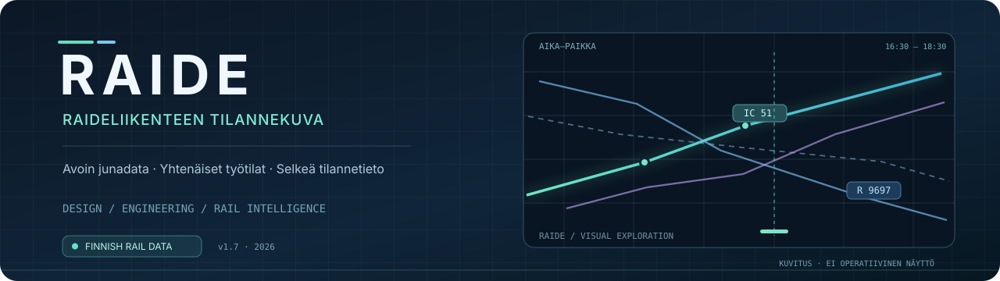

<div align="center">



# RAIDE

### Raideliikenteen tilannekuva · Railway traffic intelligence

**Suunnittelu ja toteutus / Designed & developed by Sandeep Pariyar**

[**Avaa sovellus**](https://raide-railway-intelligence-2026.sandeep-pariyar.chatgpt.site) · [**Komponentit**](#rakenne) · [**Tietolähteet**](#aineistot-ja-tulkinta) · [**Laatu ja testaus**](#laatuvaatimukset)


</div>

> **Yksi kokonaisuus, useita näkökulmia.** RAIDE kokoaa junien sijaintihavainnot, aikataulut, viiveet, muutoshavainnot ja liikennetiedotteet toisiinsa kytketyiksi työtiloiksi. Valittu juna säilyy samana, kun käyttäjä vaihtaa kartan, graafisen aikataulun ja junan etenemisen välillä.

| Tilannekuva ja havainnot | Reitit ja aikataulut | Syvempi tarkastelu |
| :--- | :--- | :--- |
| **Tilannekuva** · ajantasainen liikenne | **Elävä reittiverkko** · muuttuva kaavio | **Muutostutka** · havaintojen erot |
| **Kartta** · tuoreet GPS-havainnot | **6 aikataulunäkymää** · erilaiset analyysit | **Junan eteneminen** · lähtö → havainto → määränpää |
| **Tiedotteet** · voimassaolo ja lähde | **Rataosat** · junakohtainen valinta | **Tilanneanalyysi** · tapahtumahistoria |

<p align="center"><sub>Portfolio- ja analyysityökalu · Ei turvallisuuskriittiseen liikenteenohjaukseen</sub></p>

---

## Mikä RAIDE on?

Suomenkielinen, valtakunnallinen junaliikenteen verkkosovellus ja uudelleenkäytettävä Web Components -komponenttikirjasto. Suunnittelu ja toteutus: **Sandeep Pariyar**.

**Versio 1.7 — käyttöliittymän ja tietojen luotettavuuden uudistus:** tärkeimmät analyysi-, reitti-, junan etenemis- ja aikataulutyötilat voi laajentaa koko näytölle. Hakutulos paikantaa junan tai liikennepaikan reittiverkossa; verkko on sovitettavissa ruudulle ja seuraa valittua junaa. Reittipisteitä ohittava junamatka säilyy näkyvissä erikseen merkittynä selvittämättömänä aikataulujaksona. Toteuma, ennuste, peruutus, epävarmuus ja suunnittaiset junamäärät erotellaan. Seuraavan ja nykyisen liikennepaikan päätelmät, puutteellinen junamäärä ja tuntemattomat viiveet on korjattu. Osittainen reaaliaikainen junadata merkitään näkyvästi. Tämä on julkisten aikataulu- ja havaintotietojen analyysityökalu, **ei opastin-, raidevaraus- tai liikenteenohjausjärjestelmä**. [Tarkastusten rajat](VERIFICATION.md) kertoo myös, mitkä selaintarkistukset ovat vielä tekemättä.

**Versio 1.6 — elävä reittiverkko:** uusi Rail Route -tyylinen, muuttuva **Elävä reittiverkko** -työtila, jonka julkaistujen aikataulupisteiden kaavio päivittyy aika-, ennuste- ja toteumatietojen mukana. Se sisältää rataosavalinnan, liittyvät yhteydet, junatunnukset, aikaikkunan, tietotasot, lähennys-/loitonnustoiminnot ja oman tallenteen aikavalitsimen. Lisäksi reaaliaikaiseen junaluetteloon yhdistetään `/live-trains`-aineisto, jotta edellisen päivän vuoroja ei riippuvaisesti kadoteta puuttuvan GPS:n vuoksi. Edellisen version **Muutostutka**, **Junan eteneminen**, kuusi graafisen aikataulun esitystapaa ja koko uudistettu ulkoasu säilyvät. [Lähdetiedon hyväksymisportit](LIVE_SCHEMATIC_ACCEPTANCE.md) kuvaavat esityksen rajat. [Kansainvälinen rautatietutkimus](KANSAINVALINEN_RAUTATIEVERTAILU.md) vertailee Japanin, Ison-Britannian, Yhdysvaltain, Australian, Saksan, Alankomaiden ja Ranskan käytäntöjä.

Itsenäinen portfolio-projekti. Sovellus ei ole Fintrafficin palvelu eikä liikenteenohjausjärjestelmä.

**Tekijänoikeus:** © 2026 Sandeep Pariyar. Kaikki oikeudet pidätetään. RAIDE-lähdekoodi on julkisesti nähtävillä portfolio- ja arviointitarkoituksiin; siihen ei myönnetä yleistä käyttö-, muokkaus- tai jakelulisenssiä. GitHubin käyttöehdot ja sovellettavan lain poikkeukset ovat voimassa. Kolmansien osapuolten aineistot, kirjasimet ja ohjelmistoriippuvuudet säilyttävät omat lisenssinsä. [Lue tekijänoikeusilmoitus](COPYRIGHT.md).

## Käyttöönotto

Node.js 22 tai uudempi.

```sh
npm ci
npm run dev
```

```sh
npm test
npm run build
npm run storybook
```

Selainkulkutestit (edellyttää valmista `dist/`-rakennusta ja Playwrightin Chromium-selainta):

```sh
npx playwright install chromium
npm run test:e2e
```

Testit käyttävät mukaan pakattua tallennetta ja eristävät reaaliaikaisen rajapinnan, jotta tulokset eivät riipu sen saatavuudesta. Selainten asennus on tarpeen vain näiden testien suorittamiseksi, ei valmiin sovelluksen avaamiseksi.

Tuotantoversio syntyy `dist/`-hakemistoon. Storybook julkaistaan sen alihakemistossa `komponentit/`. Varsinaisen sovelluksen komponenttiohjeet ovat kokonaan suomeksi; Storybook on erillinen kehittäjätyökalu.

## Toiminnot

- **Kahdeksan tehtäväkeskeistä päätyötilaa:** Tilannekuva, Elävä reittiverkko, Muutostutka, Junan eteneminen, Tilanneanalyysi, Aikataulut, Tiedotteet ja Komponenttikirjasto. Koko sovelluksen junavalinta ja tallenne-/reaaliaikatila seuraavat mukana.
- **Elävä reittiverkko:** julkisiin aikataulutietoihin perustuva dynaaminen asemien/yhteyksien kaavio, jossa valittava rataosa, sivuliittymät ja tietotasot (yhteydet, ennusteet, valittu juna), 30/60/120 minuutin näkymä, havaittujen toteumien erillinen väri, klikkattavat junan seuraavan aikataulupisteen tunnukset, useiden junien ryhmittely, reittipisteen/yhteyden tarkennus, lähennys ja siirryttävä tallenteen aika. **Tämä ei ole fyysisen raideverkoston piirustus, eikä oikea asetinlaite-, vaihde-, opastin-, kulkutie- tai raidevaraustila.**
- **Muutostutka:** 5/15/60 minuutin havaintoikkunat, tyypeittäin väritetyt aikaosuudet, valittava havaintotyyppi ja junarajaus, napsautettavat havaintotapahtumat ja yhteys valitun junan tarkempiin tietoihin. Aikapalkkien ja tapahtumaluettelon rajaus on yhteinen. Muutokset on havaittu peräkkäisistä otoksista — tarkkaa syntyhetkeä ei väitetä tunnetuksi.
- **Junan eteneminen:** alkuasema → viimeksi vahvistettu asematapahtuma → seuraava aikataulupiste → määränpää, erillinen GPS-havaintojen paikkaesitystapa ja pysähdyskohtainen tarkastelu. Saapuminen ilman vahvistettua lähtöä on oma tilansa. Aikataulu, ennuste, toteuma ja puuttuva GPS erotellaan.
- **Yhtenäinen toiminta:** samasta muutostapahtumasta voi valita junan, vaihtaa reitti- ja sijaintiesitykseen ja tarkastella graafista aikataulua. Hakusuodatus ei vaihda käyttäjän jo valitsemaa junaa.
- **Junaliikenteen viisi valittavaa näkymää:** Kartta, Linjakaavio, Ratakaavio, Rataosat ja Junan kulku. Kartta näyttää GPS-havaintoja; linjakaavio ryhmittää junat seuraavan julkaistun aikataulupisteen mukaan; ratakaavion havainnollistavat suuntakaistat yhdistävät liikennepaikat ja junien seuraavat julkaistut aikataulupisteet. Ratakaavion voi laajentaa koko näyttöön; valitulle junalle voi vaihtaa sen rataosan. Rataosakortti avaa reitin tarkastelun; junan kulku näyttää valitun junan pysähdysten toteumat ja ennusteet.
- Valittu liikennenäkymä ja rataosa muistetaan selaimessa. Rataosakorteista, junakorteista ja junaluettelosta valinta siirtyy samalle junalle muidenkin näkymien kanssa. Junan kulusta voi avata graafisen aikataulun.
- Valtakunnallinen kartta: todelliset GPS-havainnot, tiheiden alueiden junaryhmät, lähennys, loitonnus ja siirtäminen. Ctrl + hiiren rulla lähentää osoittimen kohdalle, kahden sormen eleet tukevat kosketuslaitetta, nuolinäppäimet ja +/−/Home kartan näppäimistökäyttöä. Valitun junan viimeiseen GPS-havaintoon voi kohdistaa kartan.
- Junan valinta yhdistää kartan, junaluettelon, tiedot ja graafisen aikataulun.
- Liikennelajin, liikennepaikan ja junan haku. Täsmällinen liikennepaikan nimi ohittaa osittaiset nimiosumat: Oulu ei tarkoita Oulunkylää.
- Aikaeron mukainen järjestäminen ja myöhässä olevien junien suodatus.
- Aikataulut, ennusteet ja toteumat erillisinä tietoina.
- Valitun junan kokoonpano: veturit, vaunut, osuudet, pituus ja suurin nopeus silloin, kun tieto on rajapinnassa saatavilla.
- Graafinen aikataulu: valittavat rataosat ja junan oma reitti, yhden, kahden tai neljän tunnin aikavälit sekä aikasiirto.
- **Aikataulun kuusi näkymää:** Aika–paikka (valikoidut junapolut), Viivekartta (kelloon tasatut liikennepaikka–15 min -ruudut, joissa tuntematon viive, vahvistettu nolla ja ei tapahtumia erotetaan toisistaan), Junien aikajanat (jokaiselle junalle oma rivi), Asemamatriisi (junat rinnakkain liikennepaikoittain), Poikkeamat (valitun junan minuuttipoikkeamat) ja Liikennevirta (pysähdysten saapumis- ja lähtömäärät).
- **Näyttöasetukset:** piirrettävien junien määrä (12/24/48/kaikki), näkyvät tunnukset, aika–paikka-kuvan tietotasot, valitun junan tarkennus, viivekartan mittari, aikajanojen järjestys sekä liikennevirran liikennepaikka ja aikajakso. Valinnat säilyvät saman selaimen paikallisessa tallennustilassa, jos se on käytettävissä. Oletukset voi palauttaa.
- **Tilanneanalyysi:** havaittujen viiveiden jono, valitun junan pysähdysten ennuste- ja toteumatiedot, reittiin mahdollisesti liittyvät tiedotteet ja linkki graafiseen aikatauluun.
- **Havaintohistoria:** reaaliaikatilassa vain tämän selainistunnon peräkkäisten havaintojen muutokset; tallennetilassa havaintokehysten aikajärjestys. Valitun junan rajaus ja JSON-vienti.
- Suomenkieliset matkustajainformaation tiedotteet ja niiden voimassaolo.
- Todellisten havaintojen toisto: aloitus, keskeytys, aikasiirto sekä 1×, 5× ja 20× nopeus.
- Suodatettujen junatietojen vienti JSON-muodossa.
- Näppäimistökäyttö, näkyvä kohdistus, kohdistuksen palauttava tietovalintaikkuna ja tekstimuotoiset tilaviestit.

## Rakenne

| Moduuli                                 | Vastuu                                                           |
| --------------------------------------- | ---------------------------------------------------------------- |
| `src/domain.ts`                         | Junien yksilöinti, aikaerot, suodatus ja aikavyöhyke             |
| `src/service.ts`                        | HTTP, aikakatkaisu, pyyntöjen keskeytys ja tallenteen purkaminen |
| `src/worker.ts`                         | Suodatus, järjestäminen ja yhteenvetoluvut Web Workerissa        |
| `src/components.ts`                     | Kartta, junaluettelo, junan tiedot ja tilakomponentit            |
| `src/traffic-views.ts`                  | Viisi valittavaa junaliikenteen esitystapaa ja yhteiset valinnat |
| `src/schematic.css`                     | Ratakaavion saavutettava, laajennettava esitystapa               |
| `src/network-analytics.ts`              | Rataosien, aikataulupisteiden ja junan kulun laskentasäännöt     |
| `src/composition.ts`                    | Kokoonpanon esittäminen                                          |
| `src/timetable.ts`                      | Vuorovaikutteinen graafinen aikataulu                            |
| `src/timetable-advanced.ts`             | Viivekartan, junien aikajanojen ja liikennevirran Web Components |
| `src/timetable-analytics.ts`            | Aikataulunäkymien erilliset laskenta- ja ryhmittelysäännöt       |
| `src/investigation-model.ts`            | Tilanneanalyysin tietomuutosten ja poikkeamien tulkinta          |
| `src/investigation.ts`                  | Tilanneanalyysin uudelleenkäytettävä Web Component               |
| `src/change-radar-model.ts`             | Havaintomuutosten aikarajaukset, suodatus ja histogrammilaskenta |
| `src/change-radar.ts`                   | Muutostutkan vuorovaikutteinen tapahtumanäkymä                   |
| `src/train-progress-model.ts`           | Junan asematapahtumien, suunnan ja GPS-lähteen todennus          |
| `src/train-progress.ts`                 | Junan etenemis- ja sijaintiesitykset                             |
| `src/living-network-model.ts`           | Julkaistujen reittipisteiden väliset yhteydet ja lähdeluokat     |
| `src/living-network.ts`                 | Muuttuva rataliikenteen reittiverkko ja aikakontrollit           |
| `src/living-network-acceptance.test.ts` | Riippumattomat reittiverkon lähdetotuuden testit                 |
| `src/hmi-interaction.ts`                | Kartan kosketus- ja näppäimistökäytön laskenta                   |
| `src/motion.css`                        | Liikkeen esteettömyys- ja palauteperiaatteet                     |
| `src/operational-acceptance.test.ts`    | Turvallisuuskäsitteiden ja reunatapausten riippumaton testaus    |
| `src/main.ts`                           | Sovelluksen yhteinen tila, päivitys ja toisto                    |
| `design/tokens.json`                    | Yhteiset visuaaliset määritykset token-muodossa                  |
| `.storybook/` ja `src/*.stories.ts`     | Komponenttien erilliset käyttöesimerkit                          |

Kartan geometrian ja reittiyhteyksien laskentaa välimuistitetaan. Web Worker säilyttää aineiston; uudet hakuehdot eivät siirrä koko päiväaineistoa uudelleen. Junaluettelo näyttää aluksi enintään 80 riviä, ja lisärivit ladataan käyttäjän pyynnöstä.

## Aineistot ja tulkinta

Junaliikenteen lähde: **Fintraffic / Digitraffic**, [CC BY 4.0](https://creativecommons.org/licenses/by/4.0/deed.fi). [Rajapinnan dokumentaatio](https://www.digitraffic.fi/rautatieliikenne/).

Käytetyt rajapinnat:

- `/metadata/stations`
- `/trains/{departureDate}`
- `/train-locations/latest/`
- `/live-trains` (lähiaikaiset aikataulutapahtumat, ei fyysisen liikkeen vahvistus)
- `/passenger-information/active`
- `/compositions/{departureDate}/{trainNumber}`

Päivän vaihteessa tuoreissa sijaintitiedoissa esiintyvät edellisen lähtöpäivän junat haetaan erikseen. Junan yksilöi lähtöpäivän ja numeron yhdistelmä. Ajat esitetään `Europe/Helsinki`-aikavyöhykkeellä. Sijainteja päivitetään 15 sekunnin ja aikatauluja noin minuutin välein näkyvällä välilehdellä.

Seurannassa ovat käynnissä olevat junat, tuoreissa sijaintitiedoissa esiintyvät junat ja noin 90 minuutin kuluessa lähtevät vuorot. Aikataulunäkymässä on koko haettu päiväaineisto. Aikataulussa-osuus käyttää vain junia, joiden aikaero tunnetaan; se ei ole Fintrafficin virallinen täsmällisyysmittari.

Kartalla näytetään enintään kymmenen minuuttia vanhat sijainnit. Kartan reittiyhteydet johdetaan aikataulujen liikennepaikoista; ne eivät ole tarkkaa ratageometriaa. Graafisen aikataulun etäisyydet arvioidaan liikennepaikkojen koordinaateista. Varaustiloja, opastimien tiloja tai ajolupia ei päätellä GPS-tiedoista.

**Muutostutkan lähdetarkkuus:** havaintopalkit koostuvat vastaanotettujen aikatauluotosten keskinäisistä eroista. Aikaleima kertoo havaitsemisesta, ei rautatieverkon tapahtuman todennettua syntyhetkeä. Selaimessa avattu reaaliaikatila kerää muutoksia vasta peräkkäisten onnistuneiden päivitysten jälkeen; puuttuva palkki ei todista liikenteen häiriöttömyyttä. Junan etenemisen GPS-piste on **viimeinen vastaanotettu sijaintihavainto**, eikä RAIDE simuloi väliin jäänyttä matkaa tai päättele rataraidetta.

**Linjakaavio ja Ratakaavio eivät esitä todellista raiteistoa:** molemmissa juna liitetään seuraavaan julkaistuun asemakohtaiseen aikataulupisteeseen, ei tarkkaan sijaintiin raiteella. Ratakaavion rinnakkaiset suuntakaistat ja haarautumat ovat havainnollistavia, eivät todellisia vaihteita, kulkuteitä tai raidevarauksia. Rataosayhteenveto perustuu junan aikataulureitin vähintään kahteen nimettyyn liikennepaikkaan. Sama juna voi kuulua useaan rataosaan. GPS-luku kertoo korkeintaan 10 minuuttia vanhoista, tunnistettavista sijaintihavainnoista. Junan kulussa erotetaan aikataulu, ennuste ja toteuma; puuttuvaa ennustetta ei tulkita täsmälliseksi saapumiseksi. GPS-rajapinnan häiriö ei estä aikataulujen reaaliaikaista näyttöä, ja tiedonpuute ilmaistaan erikseen.

`public/data/recording.json` sisältää 15 todellista havaintokehystä 22.11.2026 klo 14.12–14.21 Suomen ajassa. Deltaesitysmuoto säilyttää aikaleimat ja havaittujen muutosten järjestyksen. Tallenne ja reaaliaikaiset tiedot erotetaan käyttöliittymässä. Kokoonpano haetaan erikseen eikä kuulu sijaintitallenteeseen.

RAIDEn havaintohistoria vertailee peräkkäisiä otoksia. **Havaitsemisaika ei ole tapahtuman tarkka syntyhetki**, eivätkä nämä otokset takaa kaikkien välissä tapahtuneiden muutosten löytymistä. Istuntohistoriaa ei talleteta palvelimelle. Tiedotteen ja valitun junan välinen yhteys voi perustua joko junatunnukseen tai reitillä olevaan liikennepaikkaan; jälkimmäinen ei tarkoita vahvistettua junakohtaista häiriötä.

Viivekartan solut lasketaan junan arvioidun, toteutuneen tai aikataulun mukaisen liikennepaikka-ajan perusteella. Sama juna lasketaan yhden liikennepaikan ja 15 minuutin solussa enintään kerran. Keskimääräinen viive perustuu vain tunnettuihin **positiivisiin** aikaeroihin. Liikennevirran pylväät laskevat kaupallisia saapumis- ja lähtötapahtumia; ne eivät ole ratakapasiteetti-, vaihde-, opastin- tai raidevaraustietoja. Aikajanojen korostettu ennuste-/toteumajakso sisältää tarvittaessa aikataulutietoja puuttuvien havaintojen kohdalla.

Pohjakartta: **Natural Earth**, public domain, [datasets/geo-countries](https://github.com/datasets/geo-countries). Pohjakartan geometria on yksinkertaistettu selainta varten. Kirjasimet: **IBM Plex Sans ja IBM Plex Mono**, SIL Open Font License; lisenssit ovat `public/fonts/`-hakemistossa. Kirjasimet tarjotaan sovelluksen omista tiedostoista.

## Terminologia

Rautatiekäsitteet tarkistetaan Fintrafficin ja Digitrafficin dokumentaatiosta. Esimerkiksi graafinen aikataulu ja raiteistokaavio tarkoittavat eri asioita. Sovelluksen omat komponenttinimet on erotettu lähteiden käsitteistä komponenttikirjaston sanastossa.

- [Fintraffic: RUMA-ohjeet](https://www.fintraffic.fi/fi/raide/raideliikenteenpalvelut/tietojarjestelmat/ruma/faq-usein-kysyttya)
- [Digitraffic: graafinen aikataulu](https://www.digitraffic.fi/sovellukset/julia.html)
- [Traficom: saavutettavuuden tarkastusohje](https://www.saavutettavuusvaatimukset.fi/fi/kattavan-valvonnan-tarkastusohjeet/verkkosivuston-kattavan-valvonnan-tarkastusohje)

## Laatuvaatimukset

Jokaisella näkyvällä toiminnolla on toteutus. Puuttuvaa ennustetta ei esitetä nollana. Yhteyshäiriötä ei esitetä onnistuneena päivityksenä. Aineiston, tilan ja ajankohdan on oltava käyttäjän ymmärrettävissä.

Testit kattavat junan yksilöinnin, talvi- ja kesäajan, Suomen päivämäärän, aikaerot, puuttuvat tiedot, Oulu/Oulunkylä-haun, aikakatkaisun, osittaisen API-virheen ja todellisen tallenteen eheyden. Selaintarkastukset täydentävät testejä; automaattinen saavutettavuustarkastus ei yksin takaa saavutettavuutta.

Storybookin staattinen rakennus käyttää ympäristökohtaisesti tyhjää verkkoliitäntäluetteloa, jos käyttöympäristö ei salli käyttöjärjestelmän liitäntätietojen lukemista. Tämä koskee vain rakennustyökalun osoitteiden luettelointia.
